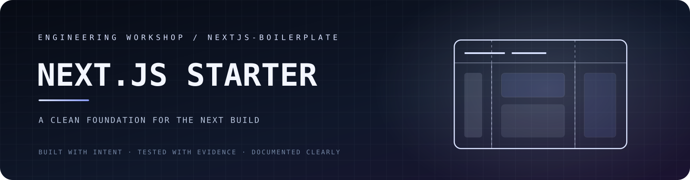
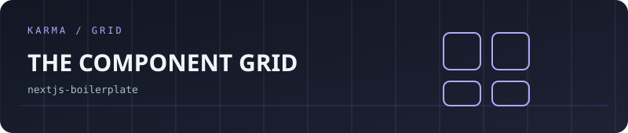

<p align="center"></p>

<p align="center">
  <a href="https://github.com/vishwasaithalz/nextjs-boilerplate/actions/workflows/tests.yml"></a>
  
  
  
  
</p>

<p align="center"><strong>A deliberately minimal foundation for the next web application.</strong></p>

<p align="center">[Stack](#-stack) · [Setup](#-setup) · [Quality checks](#-quality-checks) · [Production checklist](#-before-production)</p>

## 🧱 Stack

- Next.js 16 with the App Router.
- React 19.
- TypeScript.
- Tailwind CSS 4.
- ESLint 9.

## ⚡ Setup

**Requirements:** Node.js 20.9 or newer and npm.

```powershell
git clone https://github.com/vishwasaithalz/nextjs-boilerplate.git
cd nextjs-boilerplate
npm ci
npm run dev
```

Open [http://localhost:3000](http://localhost:3000).

## 🧪 Quality checks

```powershell
npm run lint
npm run build
```

## 🗂️ Project structure

```text
app/
  globals.css   Global styles and Tailwind import
  layout.tsx    Root layout and metadata
  page.tsx      Starter landing page
public/         Static assets
```

## 🔐 Before production

- Replace starter content and metadata with product-specific information.
- Validate server-side environment variables.
- Never expose secrets through `NEXT_PUBLIC_*` variables.
- Keep `.env.local` out of version control.
- Add authentication, authorisation, and tests when the application requires them.
- Review security headers, accessibility, performance, and deployment settings.

## 🗺️ Roadmap

- [ ] Add a small accessible component example.
- [ ] Document environment configuration.
- [ ] Add a minimal page and API test strategy.
- [ ] Keep the starter lean; add dependencies only when needed.

## 📚 References

- [Next.js documentation](https://nextjs.org/docs)
- [TypeScript documentation](https://www.typescriptlang.org/docs/)
- [Tailwind CSS documentation](https://tailwindcss.com/docs)

<p align="center"><sub>Start clean. Add only what the product needs.</sub></p>


<!-- KARMA VISUAL IDENTITY: START -->
<div align="center">

**WEB FOUNDATION / NEXT.JS**

 

<sub>Designed for clarity. Built for evidence. No invented status metrics.</sub>

</div>
<!-- KARMA VISUAL IDENTITY: END -->


<!-- KARMA ANIMATED SIGNAL -->
<p align="center"></p>
<details><summary><strong>🎛 Explore the interactive KARMA universe</strong></summary><p><a href="https://karma-ops-monitor.vercel.app">Launch the music-enabled KARMA homepage</a>. Sound is user-controlled. Motion can be reduced.</p></details>


<!-- KARMA AVATAR GALLERY -->
<p align="center"></p>
<p align="center"><a href="https://karma-ops-monitor.vercel.app/#gallery">Explore the animated project gallery</a></p>
